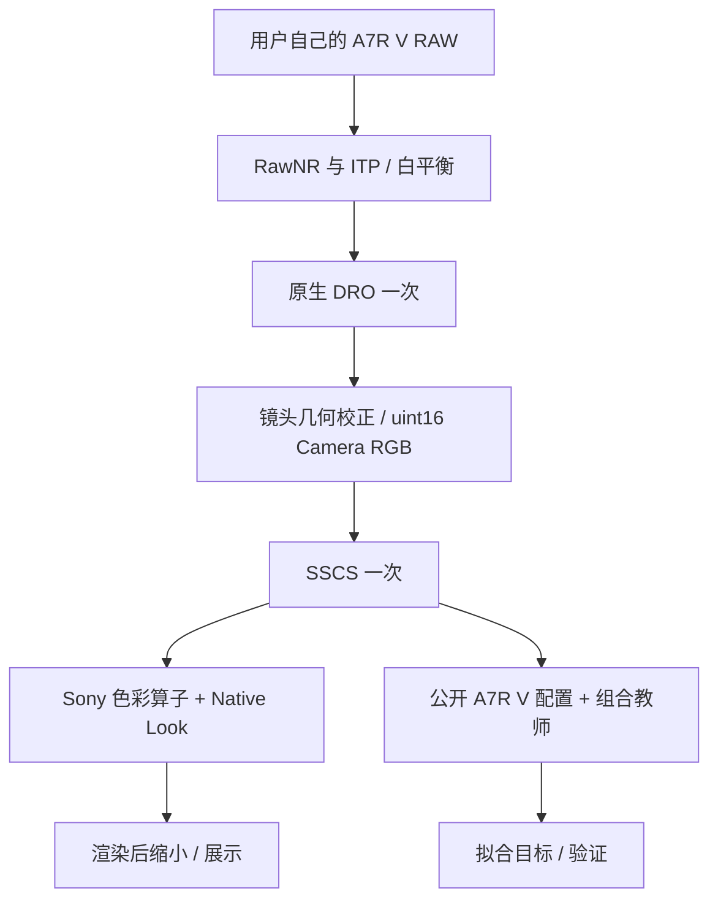

# 原理、实际教师与主观取舍

本项目是 **HNCS-inspired / 仿 HNCS** 的非官方色彩近似。HNCS 名称说明参考方向，不能把这里的软件结果称作哈苏相机直出、官方 HNCS 移植或 Adobe 完整显影的等价实现。

## 本版本究竟在拟合什么

发布的 `HNCS_Unified_Only.a7look` 对应教师身份：

```text
a7rv-hncs-public-colour-vlog-tail-physical-v1
```

它把 **HNCS-Lightroom 的 A7R V 色彩配置**与 **V-Log-Alchemy 的显示影调尾链**组合起来。网页上的 Adobe 栏则是 Camera Raw 实际加载配置后的完整 RAW 显影，两者的输入解释、白平衡、处理顺序与影调链存在差异。当前发布参数没有以 Adobe 输出的逐像素最小误差作为最终选择依据。

本项目偏好更自然的绿色、克制的蓝色，以及某些场景下较轻的偏黄观感。这些是维护者的主观选版倾向，体现在教师组合、约束投影和最终版本选择中；并不是三项已经证明普遍改善的客观指标。代码里没有发布后暗加的全局去黄、绿色替换或按照片分别调色模块。更换参考教师与选择参数会改变观感，因此公开实际链路比声称“精确还原哈苏”更有意义。

## 共用物理输入



前端调用固定提交的 `751K/sony-a7m5-looks` 数学实现，使用输入 RAW 自己的标定。DRO 位于共用前端，Look 不附带第二层 DRO。先执行真实邻域下的 RAW 处理与颜色运算，最后才缩小显示 RGB；不能用平均后的 RAW 颜色代替物理像素输入。

`prepare` 在 12×8 个空间位置提取 64×64 邻域，默认每块分层选取 64 个实际像素。有效性掩码考虑传感器饱和、白平衡工作域裁剪及邻域传播，仅用于拟合选点，不成为最终 Look 的运行时遮罩。

## 教师的实际执行顺序

入口：[teacher/reference.py](src/hncs_native/teacher/reference.py)、[teacher/phocus.py](src/hncs_native/teacher/phocus.py)、[teacher/vlog_reference.py](src/hncs_native/teacher/vlog_reference.py)。类名 `HNCSTeacher` 不表示它调用了 Phocus。

1. 对 post-GeoCorr `uint16` Camera RGB 应用一次 Sony SSCS。
2. 使用输入标尺 **8192** 归一化；由 RAW 的 As Shot neutral 求 DCP 三光源状态，处理已白平衡输入与 Camera White 的关系。
3. 使用公开 A7R V DCP 的三光源 ColorMatrix / ForwardMatrix，将相机颜色变换到 PCS 与 ProPhoto 工作域。
4. 依次运行白平衡相关 HueSatMap、DCP 中的 Adobe LookTable，以及 `HNCS.xmp` 的固定 HNCS 色表。
5. 变换到资源所描述的 Hasselblad RGB 工作空间。
6. 非负处理后采用 V-Log-Alchemy 的 **knee=0.5 Reinhard shoulder**，接其 65,536 项 Standard Film Curve。
7. 按该资源的 ICC TRC 解码，执行工作空间到显示空间的色适应／矩阵变换，再编码为 sRGB 并裁剪。

这里的标尺、白平衡和处理顺序属于教师定义，不能用“最后提亮一点”来替代。Carrier HSM 之前存在 `[0,1]` 裁剪；后续两张 SDR 色表对超过 1 的颜色采用代码中的同质扩展。V-Log-Alchemy 的 shoulder 是该开源项目的显示扩展，并非本项目证明从 Phocus 原厂逐阶段恢复出的处理。

我们没有在完成 HNCS 色表后再叠加一遍 V-Log 的 daylight ColorCorrect，以免重复色彩映射。教师只复用它的显示尾链；独立 `VLogReference` 类同时保留其原有测试接口。XMP 中读到的 PV2012 曲线也没有和这里选用的 Film Curve 再叠加。

### 与 Adobe 实际 HNCS 的关系

Adobe 栏的依据是用户实际运行 Camera Raw 的导出，使用 HNCS-Lightroom 的 A7R V Base / HNCS Look、As Shot 白平衡及其 Film Tone。Adobe 仍会执行自己的 RAW 前端、Process Version、曝光与高光处理及输出过程。本项目没有获得 Adobe 专有完整处理链的源码，也没有声称 Python 教师复现了它。

公开核心中的 `--mode teacher` 渲染上述**组合教师**；不能把它的输出标成“Adobe 实际导出”。若要重新制作 Adobe 对照，应在合法安装的 Camera Raw / Lightroom 中自行加载匹配配置，记录版本、白平衡、曝光、基础调整与输出色域，并保留真实导出。静态 JPG 对比不能通过逆推恢复原始 RAW 前端。

## 被求解的 Native Look

连续阶段只有 **45 个原生控制量 + 405×3 个固定网格节点**。没有照片到颜色的神经网络、场景分类器或逐照片参数。

- 3 个影调值：gain、toe、shoulder。
- 三白平衡端点各 6 个矩阵自由系数，共 18 个。
- 三端点各 8 个 CC1 系数，共 24 个。
- 一个 5×9×9×3 有符号七位残差网格，共 1,215 个值。

每个端点的矩阵增量由六个值展开：

```text
        [ a+b   -a    -b   ]
ΔM =    [ -c    c+d   -d   ] / 1024
        [ -e    -f    e+f  ]
```

每行增量和为零，灰轴不受这部分矩阵增量改变。增量均匀应用到现有 16 个色相段；本版本没有额外的 16 段独立自由参数。白平衡权重直接使用 Sony RAW 的端点权重，包括其可能存在的外推，不强制重新归一化。

连续影调近似为：

```text
t = y / y_max
y' = y × [1 + gain + toe × (1-t)^2 + shoulder × t × (1-t)]
```

最终评价使用 Q10 整数乘法、逐步算术移位、裁剪以及 Sony LUT 重建，不把连续近似直接当作量化结果。

### 网格算子

本项目固定采用已经选定的软件模型：在 Sony 输出 RGB 上按 BT.601 limited 假设计算 Y/Cb/Cr 坐标，将其映射到 5×9×9 节点，作八角点三线性插值，将三通道网格残差除以 256 后直接加到 RGB，最后裁剪到 `[0,1]`。

输入先裁剪，坐标边界再裁剪，顺序见 [grid.py](src/hncs_native/grid.py) 与 [optimizer/unified.py](src/hncs_native/optimizer/unified.py)。连续优化内部保存 `g = integer_grid / 256`；导出时还原成 −64…63 的整数。这个固定数学模型是软件复现的前提；公开代码不包含机内 ISP 验收或固件刷写。

## 数学目标与求解

整体外观损失包含四项，均采用固定区域和稳健残差：

```text
Lappearance = 0.20 × ρ(CIEDE2000 residual)
            + 0.30 × ρ(Lab difference)
            + 0.35 × ρ(regional mean difference)
            + 0.15 × ρ(regional spread difference)
```

`ρ` 是 delta=4 的 pseudo-Huber 型函数。区域包含全图、4×6 空间区域与五个亮度区间；各照片平衡权重，避免复杂纹理的一张照片压过其他照片。历史参数对应照片积分权重 0.82、色相／饱和度／对数曝光数学积分权重 0.18。

另有网格相邻节点平滑、白平衡端点平滑及高光算子的自稳定约束。发布版历史系数分别为 0.3、0.01 与 0.05。高光不可靠颜色不接受教师逐像素色彩约束，而检查自身曝光响应中的亮度反转、色度突然增长／弯折，以及灰轴和白端点。正常有色高光不被统一强制变灰。

ST 输出与旧 Look 输出不进入最终颜色目标，旧 Look 参数仅可作初猜；当前使用的 `prior_strength=0`、`grid_ridge=0`。`JointObjective` 类也保留一般化接口，实际入口在 [problem.py](src/hncs_native/problem.py) 明确设置这些系数。

求解分为三个阶段：

1. 分段解析导数／反向链式法则驱动联合 L-BFGS-B。原生参数改变后，网格输入坐标也移动，导数包含这部分影响。
2. 固定已量化的原生控制量，稀疏优化网格。每个点只关联八个网格节点。
3. 整数邻域下降：对原生参数尝试 ±1、±4，对非灰轴网格通道尝试 ±1；灰轴三通道绑定，端点固定。只重算受影响支持及区域统计，并与完整损失复算核对。

`operator_math.py` 还公开 YCC／CC1／单调曲线的分段逆与有界线性投影工具，可用于构造初猜和分析不可表达残差。完整组合含裁剪、插值单元切换和量化，不能宣称存在全域闭式逆或已达到全局最优。

## 复现边界

历史拟合使用 24 张构造照片、12 张反复查看的验证照片，以及另外七个标定状态；验证不是盲测。历史目标配置见 [method/released-objective.json](method/released-objective.json)。原始数据与历史初猜不在仓库中，因此可以复现算子和求解方法，但不能声称用任意新照片会得到同一个参数 SHA-256。

本次公开整理没有改变已发布 Look。对 6 个实际标定状态、7,680 个普通及高亮输入，迁移版与原研究工程的 Sony 输出和教师输出最大差均为 0，反向导数一致。这是有限的软件迁移回归，不能代替机内图像验证。
