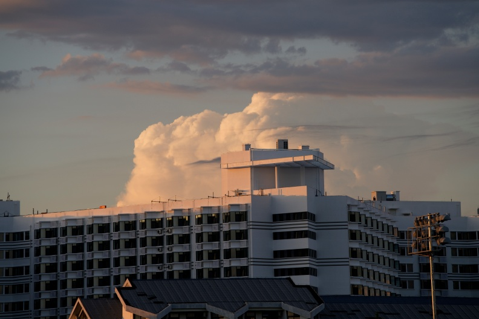
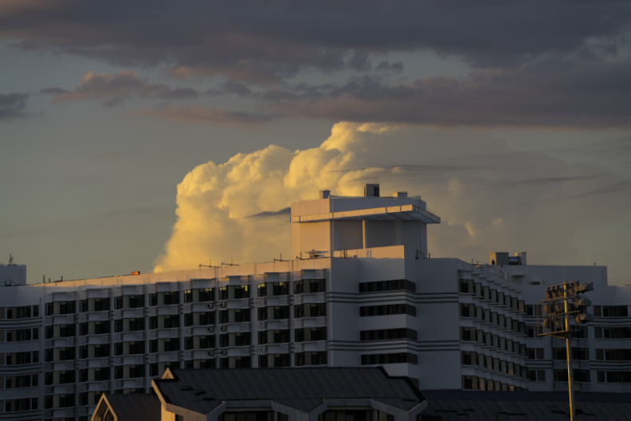
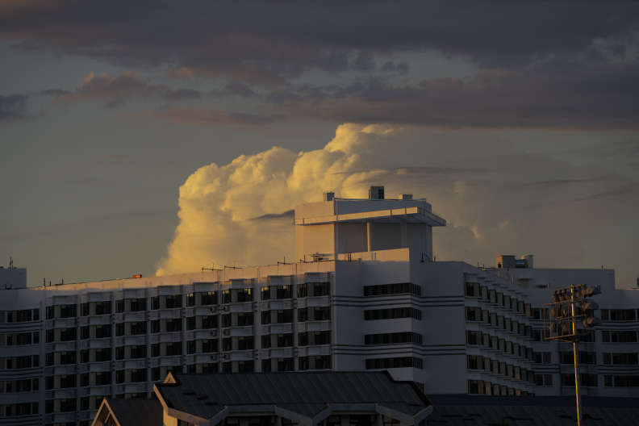

# a7r5-hncs-look

面向 **Sony A7R V / ILCE-7RM5** 的 HNCS 启发统一色彩 Look，以及 Sony ST、实际 Adobe HNCS 与本 Look 软件模拟的照片对比。

**[打开三栏对比网页](https://q734738781.github.io/a7r5-hncs-look/)** · **[下载 .a7look](looks/HNCS_Unified_Only.a7look)**

当前版本以整体观感为主，发布 `HNCS_Unified_Only`：所有样片使用同一套参数，包含三端点矩阵、CC1、Gamma 和完整 **5×9×9** 网格。Adobe HNCS 在这里作为独立对照；本 Look 不宣称精确复现哈苏官方 HNCS。

> **状态：软件模拟与拟合成果，尚未完成 A7R V 机内验证。** `.a7look` 是颜色参数文件，不是固件更新包，也不能直接通过原厂菜单安装。本项目不提供刷机工具或固件二进制。

## 照片对比

精选 9 张无人物样片：云景、雪景、湖岸夜色、花卉、新芽与食物。三栏来自同一张 A7R V RAW，但使用各自的显影流程：

| 栏目 | 来源 |
| --- | --- |
| Sony ST | Sony Imaging Edge 实际导出的 ST JPEG；沿用拍摄／导出时的设置 |
| Adobe HNCS | Adobe Camera Raw 实际加载 HNCS-Lightroom 的 A7R V 配置，以 As Shot 白平衡运行 HNCS 色彩与 Film Tone |
| 我们的 a7look | 以 A7R V RAW 标定和 Sony Edit 重建管线为基线，应用当前统一 Look 的软件结果 |

Adobe HNCS 是独立技术与观感对照。三种输出不是“同一张 ST JPEG 后套三个滤镜”。Sony 软件模拟输入已包含一次 DRO；Look 没有额外 DRO 层，Adobe 流程也没有追加 Sony DRO。

对比沿用既有同尺寸预览；部分 Adobe 输出已做几何对齐，以便比较构图。发布时没有重新拟合、额外提亮、去紫或修改颜色。27 张 JPEG 直接保留原对比预览的压缩字节，均为 792×528，已检查无 EXIF。这里只发布预览，没有 RAW、全尺寸原片或个人文件路径。

GitHub Pages 可直接浏览；也可下载仓库后在本机运行：

```sh
python -m http.server 8000 --directory docs
```

打开 `http://localhost:8000`。网页不依赖外部 CDN、账号或分析服务。

### 预览示例

| Sony ST | Adobe HNCS | 我们的 a7look |
| --- | --- | --- |
|  |  |  |

## 参数文件

- 文件：[`looks/HNCS_Unified_Only.a7look`](looks/HNCS_Unified_Only.a7look)
- SHA-256：`78ac328c0e9a073b35080200fd41d3feec1ec55942931a6b6bd56270c6bcf787`
- 基底：ST；实际标定机型：ILCE-7RM5。
- 参数：3 个 Q10 影调值、三端点各 6 个矩阵自由系数、三端点各 8 个 CC1 系数，以及 405 节点 × 3 通道的有符号七位网格。
- REA 载荷：108 字节展开参数 + 1215 字节网格。
- 同一 Look 覆盖照片白平衡变化；没有按场景分类、运行时去紫边或逐照片专属参数。

文件中的 `target: ILCE-7CM2 / 2.01` 是现有 REA 读取器要求的旧交换格式标识，**不代表本 Look 使用了 A7C II 机身标定**。实际机型写在 `hncs_native.calibration_model`。请勿据此把文件用于 A7C II。

REA 参数格式与整数运算已做离线检查，但没有因此宣称机内图像已验收。其他加载器（例如 R5ColorLab 的 BIN v4）需要完整参数换算，不能只修改扩展名。

## 验证下载内容

```sh
python tools/verify_release.py
```

该命令检查 Look 摘要、两份下载文件一致性、参数尺寸与范围、27 张预览摘要和网页素材路径，不连接相机。

## 参考与致谢

- [751K/sony-a7m5-looks](https://github.com/751K/sony-a7m5-looks)：Sony Edit 颜色管线重建和 RAW 标定解析。
- [Liwenru88/a7r5-rea](https://github.com/Liwenru88/a7r5-rea)：原生参数基底、整数运算与交换格式。
- [fishvivfish/HNCS-Lightroom](https://github.com/fishvivfish/HNCS-Lightroom)：A7R V HNCS 配置、白平衡和教师资源；Adobe 对照使用其配置。
- [shenmintao/V-Log-Alchemy](https://github.com/shenmintao/V-Log-Alchemy)：Phocus／HNCS 颜色和 Film Tone 参考。
- [QAQLeonard/a7c2-fl23-research](https://github.com/QAQLeonard/a7c2-fl23-research)：原生参数拟合及网格研究。
- [Jannchie/llr](https://github.com/Jannchie/llr)：Sony RAW 与颜色算法交叉参考。

本仓库发布 Look、精选预览和对比页，不包含完整求解器、私人训练资产、Adobe／Sony 程序或上游商业资源。Sony、Adobe、Hasselblad 及 HNCS 名称用于说明来源与比较对象，本项目与这些公司无隶属关系。

## 许可

对比页和本仓库新增工具代码采用 [MIT](LICENSE)。样片和 Look 参数不包含在该代码许可内；如需再分发或其他授权，请联系仓库维护者。上游项目保留各自许可，参见 [素材与来源说明](ASSETS.md)。
