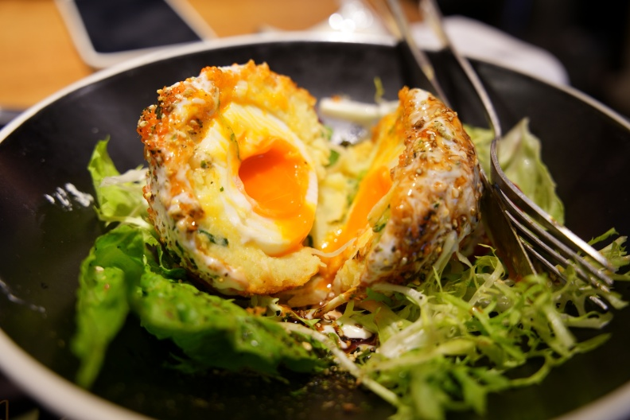
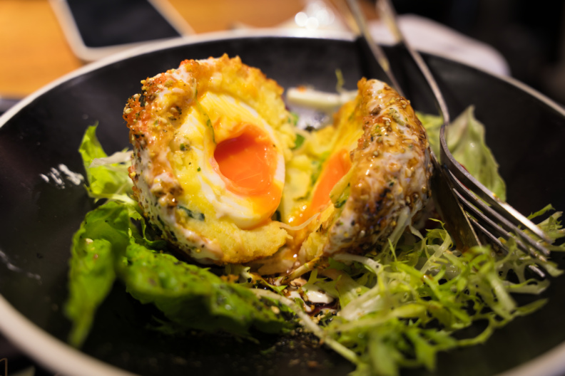
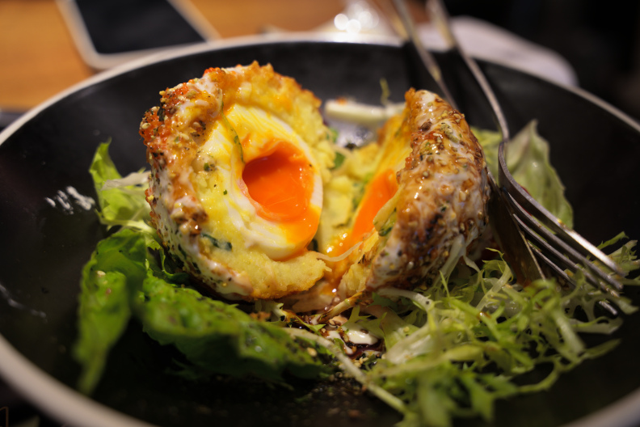

# a7r5-hncs-look

面向 **Sony A7R V / ILCE-7RM5** 的非官方 **HNCS-inspired / 仿 HNCS** 统一 Look，包含软件色彩模拟、数学拟合核心和实际照片对比。

**[打开三栏对比](https://q734738781.github.io/a7r5-hncs-look/)** · **[下载 .a7look](looks/HNCS_Unified_Only.a7look)** · **[实际教师与数学原理](METHOD.md)** · **[完整复现步骤](REPRODUCING.md)**

## 这是什么风格

以 HNCS 为参考方向，按整体观感选择一套固定参数。我们倾向自然的绿色、克制的蓝色，以及某些场景下较轻的偏黄感；这些是个人选版偏好，不是官方色彩标准或普遍改进保证。

**当前版本不是对 Adobe HNCS 的一比一拟合。** 实际拟合教师由 HNCS-Lightroom 的 A7R V 色彩配置与 V-Log-Alchemy 的显示影调尾链组合；Adobe 实际导出保留作独立比较。主观取舍来自教师组合、约束投影与版本选择，没有发布后逐张调色，也没有隐藏的绿色替换或全局去黄模块。详细顺序见 [METHOD.md](METHOD.md)。

所有样片使用同一个 `HNCS_Unified_Only`，保留三端点矩阵、CC1、Gamma 和完整 **5×9×9 网格**。没有场景分类、逐照片专属参数或额外 DRO 层。

> **软件模拟与拟合成果，尚未完成 A7R V 机内验证。** `.a7look` 是参数文件，不是固件更新包，不能直接通过原厂菜单安装。本项目不提供刷机工具、固件、密钥或商业软件程序。项目与 Sony、Adobe、Hasselblad 无隶属、授权或背书关系。

## 照片对比

主展示为苏格兰蛋。精选 9 张无人物的风景、植物与食物照片；以下三栏来自同一张 RAW 的不同处理流程：

| Sony ST | Adobe HNCS | 我们的 a7look |
| --- | --- | --- |
|  |  |  |
| Sony Imaging Edge 实际导出 | Camera Raw 实际加载 HNCS-Lightroom 配置 | A7R V 标定与 Sony Edit 重建基线上的软件模拟 |

Adobe 栏不是 Python 教师输出；Sony ST 栏也不是零增量软件模拟。Sony 模拟输入已包含一次 DRO，Look 不重复叠加；Adobe 流程未追加 Sony DRO。部分 Adobe 预览做了几何对齐，发布时没有额外提亮、去紫或修改颜色。

27 张 792×528 JPEG 保留既有预览的压缩字节并已检查无 EXIF；仓库没有原始 RAW、全尺寸原片或作者本机路径。

## 代码与原理

```text
src/hncs_native/
  sony/       Sony 原生色彩、物理 RAW 前端与整数评价
  teacher/    公开配置色彩 + V-Log-Alchemy 显示尾链
  optimizer/  解析导数、反向链式法则、稀疏网格与整数下降
  grid.py     固定 5×9×9 软件网格算子
  problem.py  仅教师色彩目标、整体观感与自稳定约束
  solver.py   联合 L-BFGS-B、网格优化和整数细化
  dataset.py  用户自有 RAW 的物理采样及显式数据清单
  format.py   .a7look 读取、校验与导出
  cli.py      渲染、采样、拟合及评价入口
```

拟合对象是已知色彩算子的 **45 个原生控制量和 1,215 个固定网格系数**。目标同时考虑稳健色差、Lab 差、区域均值及色彩／亮度分布；高光使用算子自身曝光响应的稳定性约束。最终用整数路径重新评价，旧 Look 仅作初猜，ST 与旧 Look 输出不作为颜色约束。

这不是照片到颜色的神经网络。分段逆与有界线性投影提供数学初猜／分析工具，联合阶段用解析梯度处理剩余非线性；裁剪、单元切换及量化使全域闭式解与全局最优保证都不成立。公式、实际教师顺序与历史目标权重见 [METHOD.md](METHOD.md) 和 [method/released-objective.json](method/released-objective.json)。

## 快速复现

推荐 Python 3.12，从仓库目录使用 editable 安装；先按 [REPRODUCING.md](REPRODUCING.md) 建立并激活虚拟环境。

```sh
python -m pip install -e ".[fast,dev]"
python -m hncs_native inspect
python -m pytest -q
```

确认上游资源许可后，取得三个固定版本的公开依赖：

```sh
python tools/fetch_upstream.py --fetch
python -m hncs_native doctor
```

使用自己的 A7R V RAW；下面的文件名为占位示例：

```sh
python -m hncs_native render --raw data/local/scene-01.ARW --mode look --output runs/look.png
python -m hncs_native render --raw data/local/scene-01.ARW --mode teacher --output runs/teacher.png
python -m hncs_native prepare --raw data/local/scene-01.ARW --output data/local/scene-01
```

准备其他照片后，编辑 [examples/dataset.json](examples/dataset.json) 中的相对路径与数据划分，再运行：

```sh
python -m hncs_native fit --dataset examples/dataset.json --output runs/own-fit
python -m hncs_native evaluate --dataset examples/dataset.json --look runs/own-fit/looks/HNCS_UserFit.a7look --output runs/evaluation.json
```

所有颜色运算都在物理像素上执行，最后才缩小显示 RGB。全图处理可能较慢，快速局部检查、运行预算、Adobe 实际对照和数据格式见 [复现文档](REPRODUCING.md)。

**复现范围：**可核验发布文件、复现数值方法并用自有数据重新拟合。历史 RAW、七个标定状态和原初猜未发布，因此不承诺任意新数据重新求解后得到相同系数。迁移版已与原工程做有限数值对照，也已跑通自有 RAW 的短流程；没有因此宣称真实机内效果已验收。

## 参数身份与校验

- 文件：[`looks/HNCS_Unified_Only.a7look`](looks/HNCS_Unified_Only.a7look)
- SHA-256：`78ac328c0e9a073b35080200fd41d3feec1ec55942931a6b6bd56270c6bcf787`
- 实际标定机型：ILCE-7RM5；基底：ST。
- REA 载荷：108 字节展开参数与 1,215 字节网格；本次代码公开未改变该文件。

文件中 `ILCE-7CM2 / 2.01` 是 REA 读取器使用的旧交换格式标识，不表示采用了 A7C II 机身标定，也不表示文件可以用于该机型。R5ColorLab BIN v4 等其他格式需要完整换算，不能仅改扩展名。

```sh
python tools/verify_release.py
python tools/check_publication.py
```

前者核验 Look 与 27 个预览；后者检查 Git 拟发布文件中的 RAW、缓存、个人路径及凭据标记。依赖、私人数据和运行目录均已加入忽略规则。

网页也可本地运行：`python -m http.server 8000 --directory docs`，然后打开 `http://localhost:8000`。

## 来源、许可与非官方声明

感谢 [751K/sony-a7m5-looks](https://github.com/751K/sony-a7m5-looks)、[fishvivfish/HNCS-Lightroom](https://github.com/fishvivfish/HNCS-Lightroom)、[shenmintao/V-Log-Alchemy](https://github.com/shenmintao/V-Log-Alchemy)、[Liwenru88/a7r5-rea](https://github.com/Liwenru88/a7r5-rea)、[QAQLeonard/a7c2-fl23-research](https://github.com/QAQLeonard/a7c2-fl23-research) 与 [Jannchie/llr](https://github.com/Jannchie/llr) 的研究。

本仓库新增代码采用 [MIT](LICENSE)，直接适配与外部依赖保留各自版权、许可及条件，详见 [THIRD_PARTY_NOTICES.md](THIRD_PARTY_NOTICES.md)。照片和 Look 参数不包含在代码 MIT 许可内，参见 [ASSETS.md](ASSETS.md)。上游配置、曲线、商业 LUT、程序或固件不随本仓库再分发。

“仿色”“研究”及免责声明都不能替代第三方授权或适用法律义务。项目名称只说明参考方向，不表示官方 HNCS 复现、Adobe 精确匹配或品牌背书。具体发布边界见 [LEGAL.md](LEGAL.md)。
